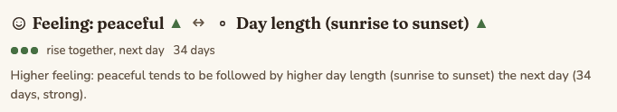
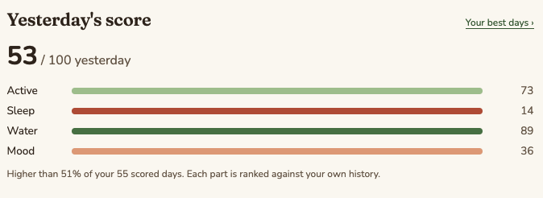
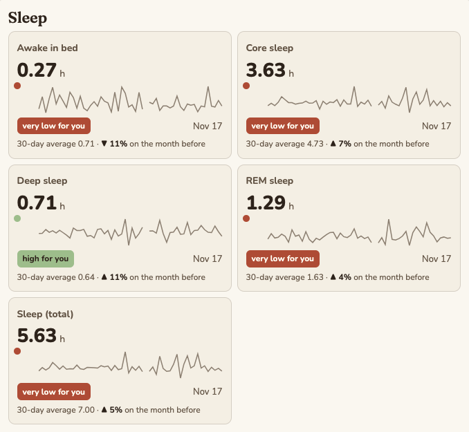
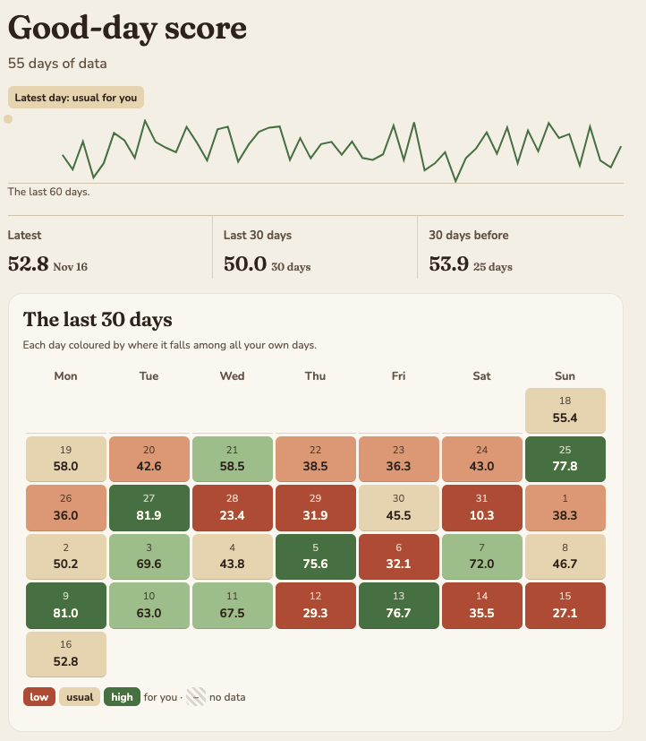

<p align="center"></p>

<h1 align="center">Health and Discovery Companion</h1>

<p align="center"><b>What goes together in <i>your</i> health data, in plain sentences, on your own server.</b></p>

> [!IMPORTANT]
> **This is a fork. Report bugs and ask questions here, not upstream.**
> Anything you hit while running this repository, including its HealthLog, goes to
> **[this fork's issues](https://github.com/JHenzi/healthlog-ml/issues)**. Please don't file it on
> [anym001/healthlog](https://github.com/anym001/healthlog): its maintainer didn't write the
> Companion and shouldn't have to sort out our changes. If the bug turns out to be in HealthLog itself,
> we reproduce it on plain upstream and report it there ourselves, with a fix when we can.

The Companion brings your Apple Health data together with what you log
yourself and the world outside (weather, daylight, the moon, holidays). It
turns all of it into one number per day per series and compares everything
with everything, in both directions. It then tells you what tends to go
together in **your** data, with the evidence attached:

> *Higher steps tends to be followed by higher sleep (total) over the next
> days, most around 3 days later (80 days, moderate).*

It has no built-in theory of what matters. Only what clears a strict
false-discovery bar is shown, and the wording never claims a cause. Nothing
leaves your machine: no telemetry, no cloud, no model APIs.

<p align="center"></p>
<p align="center"><sub>A self-tracked series on its own page: each day coloured by where it falls among your own days, and your weekday pattern.</sub></p>

<table>
<tr>
<td width="50%"><br><sub><b>Discovery</b>: a link in your data, with its days and strength.</sub></td>
<td width="50%"><br><sub><b>Overview</b>: yesterday's score, each part ranked against your own history.</sub></td>
</tr>
<tr>
<td><br><sub><b>My Metrics</b>: a tile per series, coloured low, usual or high <i>for you</i>.</sub></td>
<td><br><sub><b>Good days</b>: the score over 30 days, each day among your own.</sub></td>
</tr>
</table>

## What's in it

- **Overview**: rate your day in the evening, then look back blind the next
  morning. Yesterday compared with your usual, a good-day score, and
  Momentum: streaks, records and what's moving.
- **Trends and Worth noticing**: am I doing better or worse, and what's
  changing right now? Pin the series you care about to the Overview: this
  week against your usual, the last two weeks, your highest and lowest
  stretches, and a 26-week chart. Anything else that clearly moves shows up
  on its own, checked against noise first. Up and down, never good or bad.
  An optional push when something new has clearly changed, at most twice a
  week.
- **Discovery**: relationships on the same day, the next day or spread over
  the following week. Week and month changes and weekday rhythms, each with
  its number of days, strength, likely range and an evidence page.
- **Capture and Trackers**: measure anything (counts, ratings, times of day,
  day tags, a diary). Log from Siri, an NFC tag or the Action button via
  Shortcuts, or import your history from another tracking app.
- **My Metrics**: every series, readable. Sleep and its timing, HRV, stress,
  energy reserve, workouts, State of Mind, water, weather, and your own
  trackers.
- **Installable on the phone**, with optional push reminders. A documented
  JSON API.

The statistics: residuals after removing weekday profiles and trends,
effective sample sizes for day-to-day carry-over, one Benjamini-Hochberg
family over every test of a run, effect floors, and a validation suite
that plants effects and confounders before any method ships.

## Quick start

You need a machine with Docker, an iPhone with
[Health Auto Export](https://www.healthyapps.dev/), and about twenty minutes:

```bash
git clone https://github.com/JHenzi/healthlog-ml.git && cd healthlog-ml
cp .env.example .env && cat companion/.env.example >> .env   # HealthLog's settings + the Companion's, one file
# fill in the passwords and TZ (the README has one-liners), then:
COMPOSE="docker compose -f docker-compose.yml -f compose.local.yml -f compose.companion.yml"
$COMPOSE up -d healthlog-db          # then create the two read-only database roles (README, step 2)
$COMPOSE up -d --build
sh companion/scripts/check_egress.sh  # proves nothing holding health data can reach the internet
docker exec -it healthlog-companion companion set-password
```

Put HTTPS in front (one `tailscale serve` line does it), point Health Auto
Export at HealthLog, and open the Companion on your phone.
**[Step by step, with every command →](../companion/README.md#quick-start)**

## Security and privacy

Your health data is about as personal as data gets, so the defaults are strict and the claims are checked:

- **Nothing leaves your server.** No telemetry, no cloud, no model APIs. Everything that holds or reads
  health data (the database, HealthLog, Grafana, the Companion) sits on an **internal Docker network with no
  route out**; small forwarders publish the ports. `check_egress.sh` proves it on every deploy.
- **Opt-in outside data stays outside.** Weather and phone reminders leave from a separate collector
  container that holds no health data. Your location is rounded to ~10 km first, and reminders are
  encrypted for your phone before they leave.
- **Least privilege in the database.** The Companion and Grafana log in as their own **read-only** roles
  on HealthLog's tables, and the Companion writes only to its own schema.
- **The web app is hardened.** Password sign-in with lockout, HTTPS-only session cookies, CSRF protection
  on every form, a strict content security policy, and API tokens stored hashed with one scope each. It
  listens on localhost only, behind your HTTPS.
- **HealthLog's side:** a shared-secret ingest token, server-side de-duplication, raw payloads
  archived for replay, and TimescaleDB's and Grafana's phone-home switched off.
- **Public code, no personal data in it,** with secret scanning, CodeQL and Dependabot on every change.
  Found a security issue? See [`SECURITY.md`](SECURITY.md).

Details: [`companion/docs/privacy.md`](../companion/docs/privacy.md).

## Included from HealthLog

Running this fork gets you all of HealthLog too:

- **Its nightly analysis**: lagged correlations, anomalies, trends and seasonality, a recovery
  early-warning, sleep consistency and training load (TRIMP, ACWR).
- **A stress score and an energy reserve** (Body Battery-style) from heart rate and HRV, minute by minute.
  The Companion uses both.
- **Grafana dashboards**, HealthLog's and ours, provisioned on start.
- **Written reports from a local LLM** (`healthlog narrate`): status, weekly and monthly reviews in plain
  prose, from an [Ollama](https://ollama.com) model on your own hardware. It's off until you point it at
  Ollama. `healthlog narrate --dry-run` shows exactly what a model would receive, with no model at all.
  Narration is HealthLog's feature and its setup is in [HealthLog's README](../README.md#llm-narration).
  In this fork's locked-down network HealthLog has no route out, so it can't reach an Ollama on another
  machine as shipped.

**→ [The full Companion README](../companion/README.md)**: features, install,
settings, Shortcuts, API and CLI.

## HealthLog: the foundation, and where we contribute

**None of this exists without [HealthLog](https://github.com/anym001/healthlog)** by
[@anym001](https://github.com/anym001). It is the whole data pipeline: Health Auto Export →
FastAPI ingest → TimescaleDB, idempotent and metric-agnostic. It also has nightly statistics, a stress
and energy-reserve model, Grafana dashboards and optional local narration, all self-hosted with no
outbound calls. It is careful, well-documented work, and the Companion stands entirely on it. If you
only want your Apple Health data in your own database and dashboards, **use HealthLog directly**;
it's excellent.

This fork isn't a split. It follows HealthLog upstream, and we contribute back. Improvements that
belong in the pipeline go upstream first, as their own pull requests, and the fork picks them up from
there. Merged so far:

| Upstream PR | What it added to HealthLog |
|---|---|
| [#104](https://github.com/anym001/healthlog/pull/104) | Split oversized backfill files to fit the jsonb size limit |
| [#108](https://github.com/anym001/healthlog/pull/108) | The `daily_metrics` view and dashboards follow `TZ` |
| [#111](https://github.com/anym001/healthlog/pull/111) | Apple Health State of Mind entries in their own table |
| [#117](https://github.com/anym001/healthlog/pull/117) | Caffeine and HRV RMSSD in the metric registry |
| [#118](https://github.com/anym001/healthlog/pull/118) | Apple Watch heart rate notifications and ECG summaries |
| [#126](https://github.com/anym001/healthlog/pull/126) | "Outdoor/Indoor Cycling" workout names mapped to cycling |

Ongoing: the Companion itself was proposed upstream as the optional "dedicated web app"
([#107](https://github.com/anym001/healthlog/issues/107)), and there's more to come.

How the two fit together: the Companion reads HealthLog's tables **read-only**, through one checked
contract, and keeps its own data in its own schema. It never creates anything that depends on
HealthLog's schema, so HealthLog upgrades stay HealthLog's business.

- **HealthLog's own README** (set up the pipeline first): [`README.md`](../README.md)
- **Companion design and rules**: [`companion/docs/`](../companion/docs/) ·
  [`companion/CLAUDE.md`](../companion/CLAUDE.md)

## Bugs, ideas, questions

**[Open an issue on this fork](https://github.com/JHenzi/healthlog-ml/issues/new)**, for the Companion
*and* for this repository's HealthLog. We triage everything here first; what really belongs to
HealthLog gets reported upstream by us, reproduced on plain upstream and usually with a pull request.

<sub>Why this page lives in `.github/`: GitHub shows `.github/README.md` in place of the root one, so
the fork gets its own front page while HealthLog's `README.md` stays exactly as upstream wrote it.
Licence: AGPL-3.0, as HealthLog's ([`LICENSE`](../LICENSE)).</sub>
