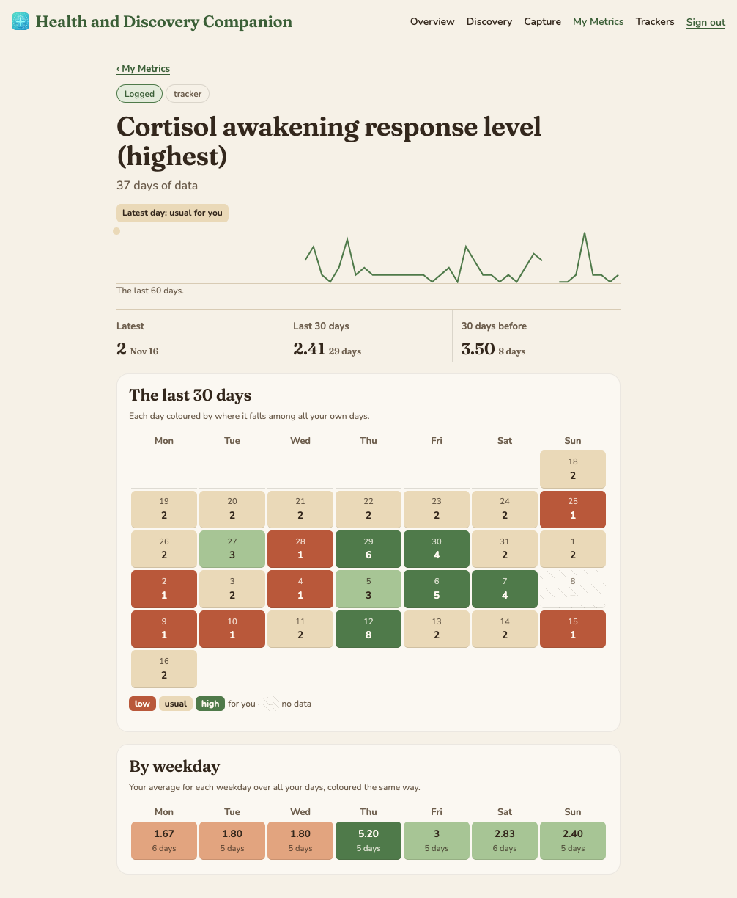

<h1 align="center">Health and Discovery Companion</h1>

<b>What goes together in <i>your</i> health data, in plain sentences, on your own server.</b>

The Companion brings your Apple Health data together with what you log
yourself and the world outside (weather, daylight, the moon, holidays). It
turns all of it into one number per day per series and compares everything
with everything, in both directions. It then tells you what tends to go
together in **your** data, with the evidence attached:

> *Higher steps tends to be followed by higher sleep (total) over the next
> days, most around 3 days later (80 days, moderate).*

It has no built-in theory of what matters. Only what clears a strict
false-discovery bar is shown, and the wording never claims a cause. Nothing
leaves your machine: no telemetry, no cloud, no model APIs.

A self-tracked series on its own page: each day coloured by where it falls among your own days, and your weekday pattern.

## What's in it

- **Overview**: rate your day in the evening, then look back blind the next
  morning. Yesterday compared with your usual, a good-day score, and
  Momentum: streaks, records and what's moving.
- **Discovery**: relationships on the same day, the next day or spread over
  the following week. Week and month changes and weekday rhythms, each with
  its number of days, strength, likely range and an evidence page.
- **Capture and Trackers**: measure anything (counts, ratings, times of day,
  day tags, a diary). Log from Siri, an NFC tag or the Action button via
  Shortcuts, or import your history from another tracking app.
- **My Metrics**: every series, readable. Sleep and its timing, HRV, stress,
  energy reserve, workouts, State of Mind, water, weather, and your own
  trackers.
- **Installable on the phone**, with optional push reminders. A documented
  JSON API.

The statistics: residuals after removing weekday profiles and trends,
effective sample sizes for day-to-day carry-over, one Benjamini-Hochberg
family over every test of a run, effect floors, and a validation suite
that plants effects and confounders before any method ships.

**→ [The full Companion README](../companion/README.md)**: features, install,
settings, Shortcuts, API and CLI.

## Built on HealthLog

The Companion runs on top of [HealthLog](https://github.com/anym001/healthlog),
the data pipeline: Health Auto Export → FastAPI ingest → TimescaleDB, with
nightly statistics and Grafana dashboards. This fork follows HealthLog
upstream and adds the Companion beside it. The Companion reads HealthLog's
tables **read-only** and keeps its own data in its own schema, so each one
upgrades on its own.

- **HealthLog's own README** (set up the pipeline first):
  [`README.md`](../README.md)
- **Companion design and rules**:
  [`companion/docs/`](../companion/docs/) ·
  [`companion/CLAUDE.md`](../companion/CLAUDE.md)

Why this page lives in `.github/`: GitHub shows `.github/README.md` in place of the root one, so
the fork gets its own front page while HealthLog's `README.md` stays exactly as upstream wrote it.
